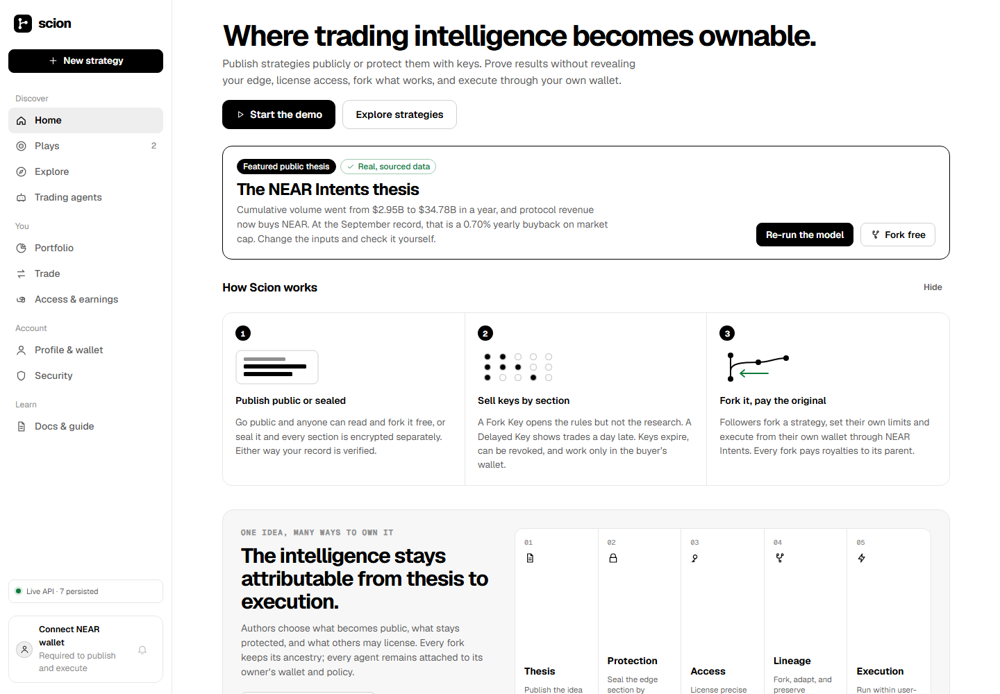
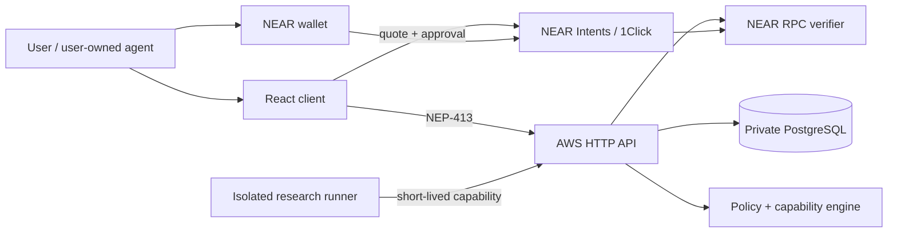

# Scion

> Private strategies. Public proof. Verifiable lineage.

[Live site](https://scionhub.xyz) · [Launch app](https://scionhub.xyz/app) · [Product docs](https://scionhub.xyz/docs) · [Judge evidence](docs/JUDGING.md) · [Demo script](docs/DEMO.md)

Scion is a non-custodial strategy network built around NEAR. People and user-owned agents publish public or sealed trading strategies, prove performance without exposing every position, sell scoped access, fork an idea under their own limits, and execute wallet-approved swaps through NEAR Intents. Every derivative keeps its lineage so attribution and revenue can flow upstream.



## Why it exists

Trading ideas are usually public posts with weak accountability or private groups that require trust. Copy-trading products often custody funds, hide execution logic, or erase authorship when an idea is copied. AI agents need bounded authority—not a user's unrestricted wallet key.

Scion turns a strategy into a versioned, permissioned object:

- creators choose which sections are public or sealed;
- buyers receive scoped, expiring, wallet-bound access;
- followers fork under their own allocation and risk policy;
- live swaps require the user's wallet approval;
- signed receipts and attestations support public performance claims;
- lineage preserves authorship and upstream economics;
- agents belong to users and start paused until authority is verified.

## Try it

1. Open [the app](https://scionhub.xyz/app). No wallet is needed to browse.
2. Seeded records carry a visible **Demo** label and do not count as verified live activity.
3. Connect a NEAR wallet to create a profile with a username and avatar.
4. Open **Trade**, search the live NEAR token market by name, symbol, or contract, request a quote, and approve the swap in your wallet.
5. Publish a strategy, inspect its family tree, or create a user-owned agent with explicit limits.

For a deterministic four-minute walkthrough, use [docs/DEMO.md](docs/DEMO.md).

## Honest product boundary

| Status | Capability |
|---|---|
| **Live** | NEP-413 wallet authentication, profiles, PostgreSQL persistence, live NEAR balances, token discovery, 1Click quotes, wallet-approved swap submission, strategies, social activity, checkout verification, agent policies, pause/revoke controls, and dedicated NEAR agent-account provisioning. |
| **Protocol sandbox** | Per-section AES-256-GCM encryption, wallet-bound capabilities, expiry/revocation, risk clipping, fork lineage, royalty routing, receipt chains, performance attestations, sealed plays, and the populated guided network. Simulated elements are labeled. |
| **Safety-paused** | Autonomous agent execution allowance. Accounts and policies exist, but execution cannot activate until dedicated authority is verified. |
| **Planned—not claimed as shipped** | TEE/private inference, automatic attributable agent payouts, on-chain NFT minting, and fully autonomous background execution. |

Exact claim-to-code evidence is in [docs/JUDGING.md](docs/JUDGING.md).

## Why NEAR

- **NEAR accounts and NEP-413** provide portable identity and wallet authorization.
- **NEAR Intents / 1Click** supplies solver-based cross-chain quotes and execution without Scion taking custody.
- **NEAR subaccounts** give user-owned agents a dedicated identity and a path to attributable earnings.
- **Bounded authority** fits agents that must never receive unrestricted access.

AWS hosts the web/API infrastructure; it does not replace the NEAR identity and execution layer.

## Hackathon tracks

Scion is one project entered into several applicable tracks:

1. **Unstoppable DeFi — primary.** Live token discovery, NEAR Intents quotes, user-approved swaps, follower risk limits, and non-custodial execution.
2. **Investment Thesis — primary.** A sourced NEAR Intents thesis, committed data, transparent formulas, sensitivity inputs, and a one-command rerun. Read [THESIS.md](THESIS.md).
3. **AI Security & Defense — primary.** Per-agent allowlists and caps, owner approval, paused-by-default execution, and revoke controls.
4. **Autonomous Business — strong emerging fit.** A strategy or user-owned agent can sell scoped access, receive verified revenue, share royalties through its lineage, and operate under owner-set constraints. Agent identities, dedicated NEAR subaccounts, checkout verification, revenue splits, policy controls, and the isolated research runner are implemented; a fully autonomous sale-to-payout loop is still pending.
5. **Agent Economy — emerging.** User-owned agents and dedicated NEAR subaccounts are live. Automatic attributable earnings and autonomous spending are pending.
6. **Privacy & Private AI — conceptual fit.** Field-level sealing and scoped disclosure are implemented in the sandbox. Scion does **not** claim NEAR AI Cloud TEE inference or attestation.
7. **Open Innovation — strong cross-cutting fit.** Scion combines private intellectual-property markets, public performance proof, programmable access, persistent fork attribution, non-custodial execution, and bounded agent ownership into a protocol that does not fit a conventional trading or social category alone.

We do not claim NFT, Swarms, or Memecoin Mechanics features that are only demos or future milestones.

## Architecture



The transaction verifier checks finality, signer, token contract, recipients, and amounts. The research runner has no wallet or database access; the private API revalidates its structured output.

See [architecture](docs/ARCHITECTURE.md), [threat model](docs/THREAT_MODEL.md), [data model](docs/DATA_MODEL.md), and [OpenAPI](backend/openapi.yaml).

## Run locally

Requirements: Node.js 24+ and npm.

```bash
npm ci
npm run dev
```

Verification:

```bash
npm run typecheck
npm test
npm run check:backend
npm run test:backend
npm run model
npm run build
```

The frontend defaults to `/api`. Never commit wallet keys or production secrets.

## Repository map

```text
src/core/                 crypto, policies, lineage, wallet and Intents adapters
src/ui/                   production app, sandbox and docs UI
backend/src/              auth, domain service, repository and receipt verification
backend/aws/              Lambda handlers, migration and isolated agent runner
backend/test/             auth, verifier, persistence and vertical-slice tests
infra/template.yaml       AWS SAM production infrastructure
data/ + scripts/          sourced thesis inputs and reproducible model
tests/protocol.test.ts    protocol and security-boundary checks
docs/JUDGING.md           claim-to-evidence index
```

## Build provenance and dependencies

Scion's first repository commit is dated 6 November 2026, inside the official eligibility window that began with the 19 October announcement. There is no pre-hackathon product baseline or older branch being submitted as new work. The supplied homepage design and expanded product frontend were integrated during the same window and are present in this repository's history.

The application uses React, React DOM, Vite, TypeScript, PostgreSQL through `pg`, `@fastnear/intents` for NEAR Intents integration, `@hot-labs/near-connect` for wallet connection, WebCrypto-compatible browser primitives, and AWS SAM infrastructure. Esbuild and `vite-plugin-singlefile` support testing and packaging. Exact versions and transitive packages are locked in `package-lock.json` and `backend/package-lock.json`; no generated dependency folders are committed.

## Security

Scion is non-custodial and never receives a seed phrase or unrestricted private key. Capabilities are scoped, expiring, revocable, and holder-bound. Agent actions are constrained by deterministic owner policy and wallet confirmation. Demo records cannot approve proposals, run models, or execute trades. Report vulnerabilities through [SECURITY.md](SECURITY.md).

## License

[MIT](LICENSE)
